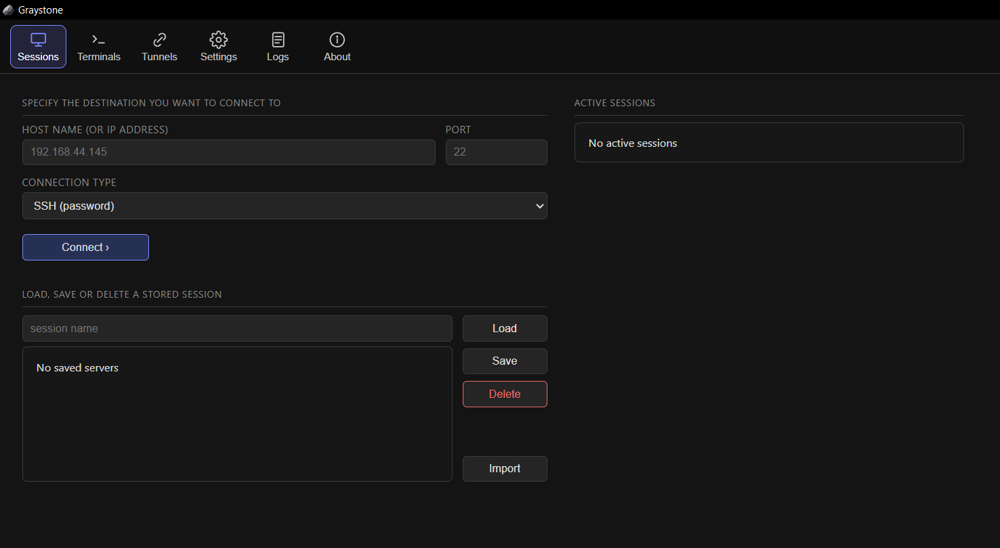

<div align="center">
  
  <br><br>
  
</div>

<h1 align="center">Graystone</h1>

A PuTTY + WinSCP hybrid for Linux servers: the terminal, the file browser, transfers and tunnels in one small Windows app. Built with Go and [Wails](https://wails.io).

**Version:** 4.9.0

## Features

- **SSH terminal** — tabbed sessions, login asked in the terminal itself (`login as:` / password / OTP), select to copy and right-click to paste. A dead link is noticed, and can reconnect on its own.
- **SFTP browser** — docked beside the terminal: upload, download, rename, delete, chmod/chown, a text editor, and a pane that follows `cd`.
- **Drag and drop** — drop files from Explorer onto the pane to upload them; drop them onto the terminal to type their paths at the prompt.
- **Transfers** — queue with progress, speed and ETA; cancel, pause and resume from the exact byte, retry after a brief link failure, and a size check on the far side before a file is called done.
- **Tunnels** — local (`-L`), reverse (`-R`) and dynamic SOCKS5 (`-D`) forwards. One table, a blank row to add one, saved per server and started again on the next connect.
- **Host key trust** — checked on first use and stored per key type, with an explicit warning when a key really changes.
- **Saved sessions** — name, host, port, key file. Ordered by dragging, imported in bulk.
- **Settings** — theme, terminal font, conflict policy, outbound proxy, reconnect. *Save settings* keeps a copy in the config folder.
- **Logs** — every action in the Logs tab, plus one file per launch.

## Privacy

Passwords and key passphrases are never stored: they are typed when connecting and kept in memory for that run. Nothing leaves the machine — no telemetry, no cloud sync, no settings file to export.

## Building

```sh
wails build   # -> build/bin/Graystone.exe
wails dev     # live reload
```

Needs Go 1.26+, Node.js, the Wails CLI v2, and Windows with WebView2. `wails build` installs the frontend packages and produces `frontend/dist` by itself; run it once before plain `go build ./...` or `go test ./...`, because `main.go` embeds that folder. `go test ./internal/...` works without it.

Developed against Go 1.26.2, Node 24 and Wails CLI v2.11; `go.mod` pins the Wails runtime at v2.12, so the CLI prints a version warning. It is harmless.

## Developing

```sh
wails build                      # once, before any Go build of the root package
go test ./...                    # the whole Go suite
cd frontend && npm test          # the frontend unit tests (node:test, no runner)
gofmt -l .                       # must print nothing; it is the formatting gate
```

Three things that are not obvious from the code and have bitten before:

- **`wails build` runs your `main()`.** To generate `frontend/wailsjs` the CLI compiles the app with `-tags bindings` and *executes* it. Anything in `main()` that touches the user's files therefore has to step aside in that mode, which is what `bindingsmode_on.go` / `bindingsmode_off.go` exist for. Add startup work that writes to disk behind `runningForBindings()`.
- **Line endings are pinned.** `.gitattributes` forces LF for `*.go`, `*.json`, `*.md`; the frontend sources (`index.html`, `src/*.js`, `src/*.css`) and `tools/*.ps1` are CRLF. A bulk find-and-replace script that rewrites whole files will silently convert one family into the other and produce a diff that touches every line. Rewrite in place and keep the endings.
- **The session list is polled.** `refreshSessions()` runs every five seconds as well as after every connect and close, so it can be in flight twice at once. It carries a ticket so a stale response cannot dispose a live terminal; keep that if you touch the function.

### Tests against a real server

`realtest/` drives the same engine the UI uses against two reachable SSH servers, so protocol, permission and transfer behaviour is checked against OpenSSH rather than a mock:

```sh
set GRAYSTONE_T1_HOST=... GRAYSTONE_T1_USER=... GRAYSTONE_T1_PASS=...
set GRAYSTONE_T2_HOST=... GRAYSTONE_T2_USER=... GRAYSTONE_T2_PASS=...
go run ./realtest
```

It is opt-in and leaves no trace: everything it creates lives under `~/graystone-realtest` on the servers and is removed on the way out, and the host-key trust store is a throwaway directory, so your real `%APPDATA%\Graystone` is never touched.

To start from an empty slate, close Graystone and delete `%APPDATA%\Graystone`.

## Files

Everything lives in `%APPDATA%\Graystone`.

| File | Contents |
|------|----------|
| `sessions.json` | saved servers |
| `tunnels.json` | saved port forwards |
| `settings.json` | the settings pinned by *Save settings* |
| `known_hosts.json` | trusted host keys |
| `graystone-<timestamp>.log` | one log per launch |

A file that cannot be parsed is renamed `<name>.bad-<timestamp>` and reported instead of being treated as empty, so a save can never overwrite what it could not read. Only one Graystone window runs at a time.
